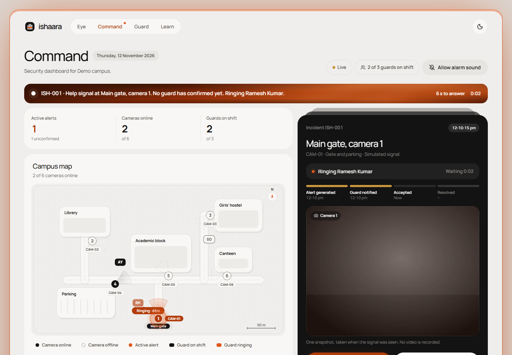
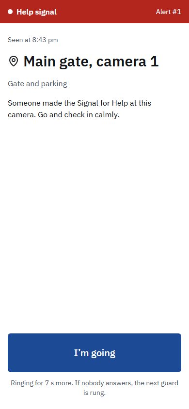
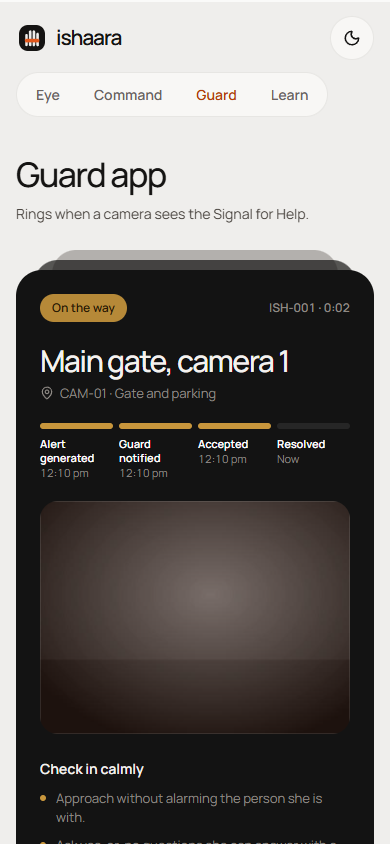

# Ishaara

Help without saying a word.

Ishaara lets a woman ask for help silently, with one hand sign, using cameras that already exist around her. A camera running Ishaara recognises the international [Signal for Help](https://canadianwomen.org/signal-for-help/), alerts campus security with the location and one snapshot, and keeps ringing guards until one confirms they are responding.

Built for HerHack 2026 (Student Innovation track).

**Live demo:** not deployed yet. See [Deploy](#deploy).

| Security dashboard                                                                   | Guard app, ringing                                                           | Guard app, responding                                                                  |
| ------------------------------------------------------------------------------------ | ---------------------------------------------------------------------------- | -------------------------------------------------------------------------------------- |
|  |  |  |

## Status

Work in progress. The project is built in phases; this list is updated as each one lands.

- [x] Phase 0: workspace, tooling and CI
- [x] Phase 1: gesture engine
- [x] Phase 2: server and escalation engine
- [x] Phase 3: design system and Ishaara Eye
- [x] Phase 4: Ishaara Command and the Guard app, installable as a progressive web app
- [x] Phase 5: Learn and Home
- [ ] Phase 6: polish and deploy (render.yaml and demo script ready; waiting for the Render service)

## How it works

1. She makes the signal towards a camera: palm open with the thumb tucked in, then fingers folded down over the thumb.
2. Ishaara Eye recognises the two shapes in order and sends one snapshot with the camera's location. No video is recorded and no faces are identified.
3. Ishaara Command shows the alert on the campus map and rings guards one at a time until one taps "I'm going".

## Surfaces

| Route      | Name            | Used by            | What it does                                               |
| ---------- | --------------- | ------------------ | ---------------------------------------------------------- |
| `/eye`     | Ishaara Eye     | Any camera device  | Watches live video in the browser and sends one snapshot   |
| `/command` | Ishaara Command | Security room      | Campus map, live alert, ring timeline, responder and timer |
| `/guard`   | Guard app       | Guards, on a phone | Rings full-screen with one "I'm going" button              |
| `/learn`   | Learn           | Students           | Teaches the signal in three steps, with webcam practice    |
| `/`        | Home            | Everyone           | What Ishaara is and links to the four surfaces             |

## Run it locally

You need Node 22.13 or newer and pnpm 10.

```sh
pnpm install
cp .env.example .env
pnpm dev
```

Open http://localhost:5173. The server runs on port 3001 and the web app proxies `/api` and `/socket.io` to it.

To run the production build the way it is deployed, as one service:

```sh
pnpm build
pnpm start
```

Then open http://localhost:3001.

## Checks

```sh
pnpm lint        # ESLint and Prettier
pnpm typecheck   # TypeScript, strict
pnpm test        # Vitest
pnpm check       # all three
```

CI runs the same checks and a build on every push to `main`.

## Project layout

```
apps/web          Vite, React, Tailwind CSS: the five surfaces
apps/server       Express and Socket.io: alert API and escalation engine
packages/gesture  Pure TypeScript gesture detection, with tests
docs              Architecture notes and the demo script
```

## Install as an app

Ishaara is a progressive web app. On a phone, open `/guard` in Chrome and use "Install the Guard app on this phone" or the browser's "Add to home screen". On a laptop, use the install icon in the address bar. Installing needs https, so use the deployed link (or `localhost` on the same machine).

## Deploy

Ishaara deploys as one Render web service: the Node server serves the API, Socket.io and the built web app. The configuration is in [render.yaml](render.yaml).

1. In Render, choose **New** → **Blueprint** and pick this repository.
2. Render reads `render.yaml`, builds with `pnpm build` and starts with `pnpm start`. The health check is `/api/health`.
3. When the service is live, open `https://<service-name>.onrender.com`.

`DEMO_MODE` is `true` in `render.yaml`. Set it to `false` in the Render dashboard for realistic timings. The free plan sleeps after 15 minutes without traffic, so open the site a minute before a demo. Alerts are kept in memory and are cleared when the service restarts.

## Demo

[docs/demo-script.md](docs/demo-script.md) has the setup and a timed script for a 2-minute demo video. On the Eye page in demo mode, Shift+S simulates a signal as a backup.

## Settings

All settings are environment variables, documented in [.env.example](.env.example). `DEMO_MODE=true` shortens the timers for presentations.

## Architecture

[docs/architecture.md](docs/architecture.md) covers the gesture rules and state machine, the camera page and its Web Worker, the REST and Socket.io API, the escalation engine, the PWA, and the design system.

```
/eye (browser)                 server (Node)                       /command, /guard (browsers)
camera -> MediaPipe worker     POST /api/alerts -> store           alert:new, alert:update
       -> signal detector  --> escalation engine rings guards  --> guard:ring -> "I'm going"
       -> one snapshot         one at a time, nearest first    <-- guard:ack
```

## Privacy

- Video is analysed on the camera's own device. Frames stay in memory and are discarded.
- The only image that leaves the device is one snapshot, at the moment a signal is confirmed.
- The model finds hand points only. It never identifies who anyone is.
- Police are never called automatically. A guard checks in first, and a person decides.
