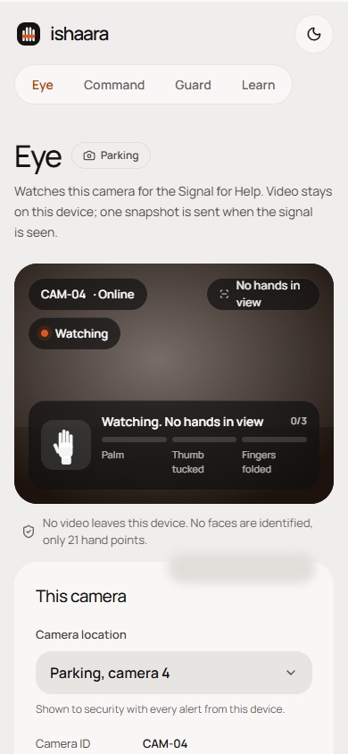
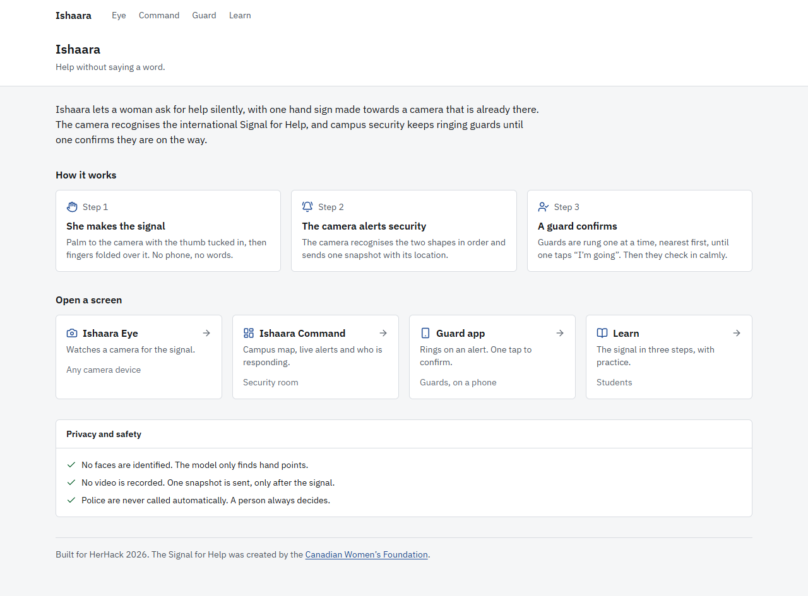
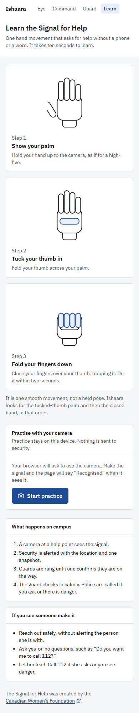
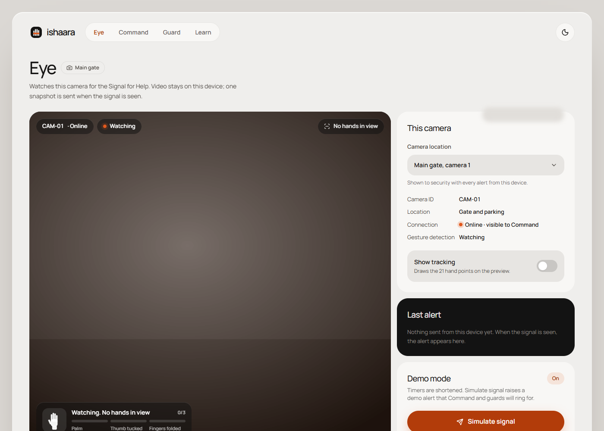
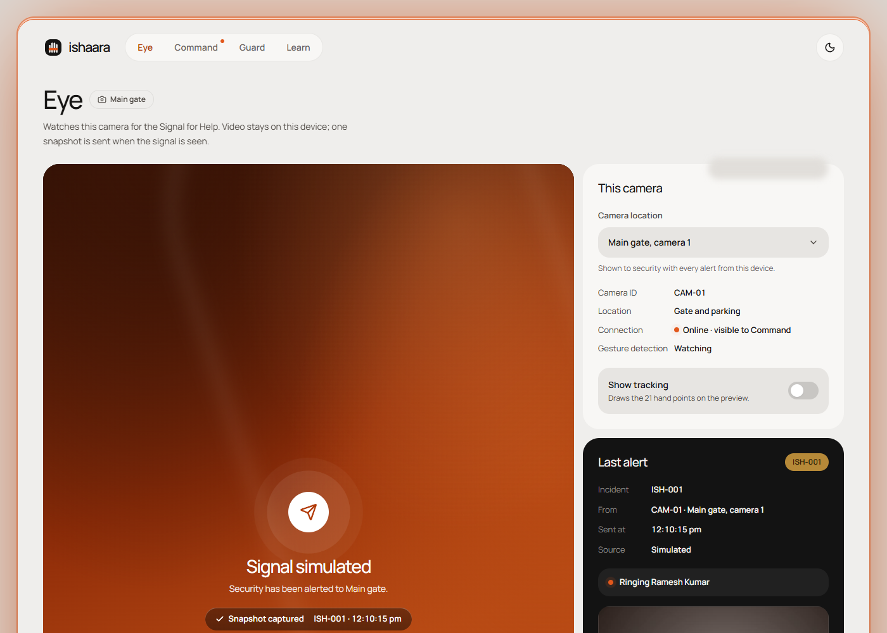
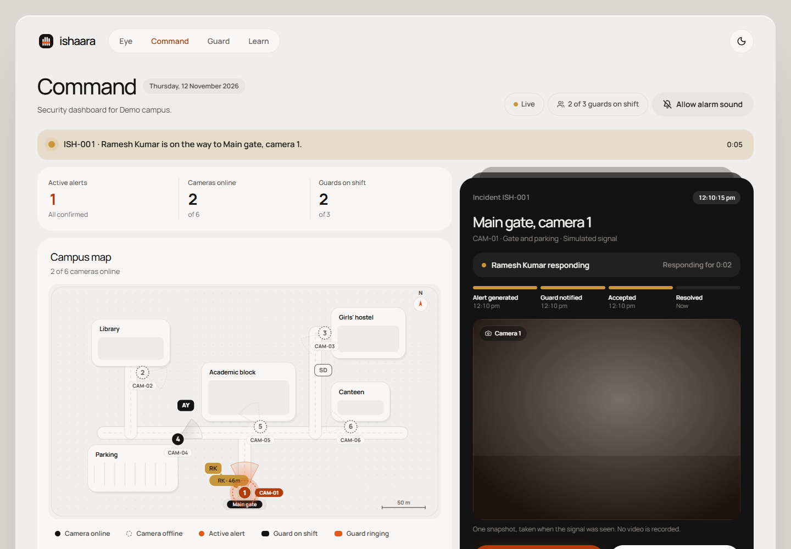

# Ishaara

**Help without saying a word.**

Ishaara lets a woman ask for help silently, with one hand sign, using cameras that already exist around her. A camera running Ishaara recognises the international [Signal for Help](https://canadianwomen.org/signal-for-help/), alerts campus security with the location and one snapshot, and keeps ringing guards until one confirms they are on the way.

_Ishaara (इशारा) is Hindi for "signal" or "gesture"._ Built for HerHack 2026, Student Innovation track.

**Live demo:** https://ishaara-pnwa.onrender.com

| Open                                                  | For                                     |
| ----------------------------------------------------- | --------------------------------------- |
| [/command](https://ishaara-pnwa.onrender.com/command) | The security dashboard                  |
| [/guard](https://ishaara-pnwa.onrender.com/guard)     | A guard's phone (installable as an app) |
| [/eye](https://ishaara-pnwa.onrender.com/eye)         | A camera; press Shift+S to simulate     |
| [/learn](https://ishaara-pnwa.onrender.com/learn)     | Learn and practise the signal           |

The free server sleeps when idle, so the first visit can take about a minute.


| Guard app, ringing                                                         | Guard app, on the way                                                               | Ishaara Eye on a phone                                            |
| -------------------------------------------------------------------------- | ----------------------------------------------------------------------------------- | ----------------------------------------------------------------- |
|  |  |  |

## Contents

- [The problem](#the-problem)
- [The Signal for Help](#the-signal-for-help)
- [How it works, end to end](#how-it-works-end-to-end)
- [The five screens](#the-five-screens)
- [Architecture](#architecture)
- [Privacy and safety](#privacy-and-safety)
- [Run it locally](#run-it-locally)
- [Try the full flow on one laptop](#try-the-full-flow-on-one-laptop)
- [Phone calls with Twilio (optional)](#phone-calls-with-twilio-optional)
- [Deploy to Render](#deploy-to-render)
- [Install as an app](#install-as-an-app)
- [Configuration](#configuration)
- [Testing](#testing)
- [Project structure](#project-structure)
- [Limits and roadmap](#limits-and-roadmap)

## The problem

In real danger, most ways of asking for help need a phone, a voice, or both, and those are exactly what an attacker controls first.

- **SOS apps need the phone in her hand.** It may be snatched, out of reach, or watched.
- **Calling or shouting can make things worse** when the attacker is right beside her.
- **Cameras are everywhere, but they only record.** CCTV is reviewed after an incident, not acted on while it happens.

Ishaara turns a camera that is already on the wall into a silent way to ask for help, and makes sure a named person answers.

## The Signal for Help

The gesture was created by the Canadian Women's Foundation in 2020 and has been shared in nearly 50 countries.

1. Show your palm to the camera.
2. Tuck your thumb into your palm.
3. Fold your fingers down over your thumb, trapping it.

It means **"reach out to me safely"**, not "call the police now". So Ishaara's first response is a guard checking in calmly, and police are called only when she asks or a guard confirms danger.

## How it works, end to end

A student is followed near the campus parking at 10:30 pm and cannot safely use her phone.

1. **She makes the signal** towards the camera at the parking help point.
2. **Ishaara Eye sees it.** The browser on the camera device runs Google's MediaPipe hand tracker on the GPU in a background worker, on every new camera frame. It finds 21 points on each hand; no face is analysed and nothing is recorded.
3. **Two shapes, in order.** Ishaara's own rules check for an open palm with the thumb tucked in (held for 5 frames), then a closed hand over the thumb (held for 5 frames) within 2 seconds. A normal fist, a wave or a thumbs-up does not count, and each hand is tracked separately so two people cannot combine their movements.
4. **One snapshot is sent.** The camera sends a single JPEG and its location ("Parking, camera 4") to the server. The camera then waits 30 seconds before it can send another, so one gesture makes one alert.
5. **Security sees it at once.** On Ishaara Command, the parking camera turns red on the campus map, a red banner names the location, and the alert card shows the snapshot and a running timer. An optional alarm sound plays until a guard confirms.
6. **Guards are rung one at a time, nearest first.** The nearest guard's Guard app rings full screen, with sound and vibration, for 20 seconds. If phone calls are set up, their phone is called at the same time. The ring timeline on the dashboard shows each step.
7. **No answer moves on.** If the first guard does not respond in time, the next nearest guard is rung, then the next. If nobody answers, the chain starts again and the alarm stays on. It never gives up on its own.
8. **The first "I'm going" wins.** The guard taps "I'm going" in the app, or presses 1 on the call. Ringing stops for everyone, the dashboard shows "Ramesh Kumar is on the way" with a timer, and any guard who answers later is told someone is already going.
9. **A calm check-in.** The guard's phone shows the location and the Foundation's guidance: approach calmly, ask yes-or-no questions, let her lead. There is a Call 112 button on the guard's phone and on the dashboard. Ishaara never calls police by itself.
10. **Closed and logged.** Security marks the alert resolved or a false alarm. The guard is told, the camera returns to normal on the map, and the alert stays in the log with its response time.

Every step above is covered by automated tests, and the whole chain has been run in a real browser with a camera page, the dashboard and two guard phones.

## The five screens

| Route      | Screen          | Used by                  | What it does                                                                            |
| ---------- | --------------- | ------------------------ | --------------------------------------------------------------------------------------- |
| `/`        | Home            | Everyone                 | What Ishaara is, how it works, links to each screen                                     |
| `/eye`     | Ishaara Eye     | A laptop or phone camera | Watches for the signal, shows a live status line, sends one snapshot                    |
| `/command` | Ishaara Command | Security room            | Campus map, live alerts, ring timeline, responder timer, Call 112, Resolve, False alarm |
| `/guard`   | Guard app       | Guards, on a phone       | Start shift, full-screen ring, one-tap "I'm going", response guidance                   |
| `/learn`   | Learn           | Students                 | The signal in three illustrated steps, with webcam practice that says "Recognised"      |

| Home                                                      | Learn (phone)                                                   |
| --------------------------------------------------------- | --------------------------------------------------------------- |
|  |  |

| Ishaara Eye, watching                              | Ishaara Eye, signal sent                                              |
| -------------------------------------------------- | --------------------------------------------------------------------- |
|  |  |

| Command, guard on the way                                                      |
| ------------------------------------------------------------------------------ |
|  |

The screenshots use a plain test feed in place of a real camera, so the snapshot shows an empty grey scene.

## Architecture

```
Camera device (browser)              Server (Node, one process)              Screens (browsers)
-----------------------              --------------------------              ------------------
/eye                                 Express + Socket.io                     /command
  webcam frames, in memory only        POST /api/alerts --> alert store        map, alert card, timeline
  MediaPipe hand tracker (Worker)      escalation engine --> alert:update -->
  signal rules (packages/gesture)        rings guards one at a time          /guard
  one JPEG on a confirmed signal --->    nearest first, until one confirms --> guard:ring
                                         <------------------- guard:ack <---- "I'm going"
                                       Twilio channel (optional) --> phone call, press 1
```

- **The camera device decides.** Video never leaves the device. The server only ever receives a confirmed alert with one snapshot.
- **One deploy.** The Node server serves the API, Socket.io and the built web app, so production is a single Render web service.
- **No database.** Cameras and guards come from [a seed file](apps/server/src/seed/campus.json). The last 50 alerts and their snapshots are kept in memory.
- **Pluggable ringing.** The escalation engine rings through "channels": the Guard app always, and Twilio phone calls when configured. A broken channel never stops the chain.

| Layer            | Technology                                                                            |
| ---------------- | ------------------------------------------------------------------------------------- |
| Hand tracking    | MediaPipe Hand Landmarker (`@mediapipe/tasks-vision`), in a Web Worker, model bundled |
| Gesture rules    | `packages/gesture`, pure TypeScript                                                   |
| Web app          | React 19, Vite, Tailwind CSS 4, React Router, lucide icons, Manrope                   |
| Server           | Node 22, Express 5, Socket.io 4                                                       |
| Phone calls      | Twilio Programmable Voice REST API (optional, no SDK)                                 |
| Install, offline | Web app manifest and service worker                                                   |
| Quality          | TypeScript strict, ESLint, Prettier, Vitest, GitHub Actions                           |

[docs/architecture.md](docs/architecture.md) has the details: gesture rules and state machine, the camera worker, every REST route and Socket.io event, the escalation engine, phone calls, the PWA and the design system.

## Privacy and safety

- **No face recognition.** The model finds hand points only. It never identifies who anyone is.
- **No recording.** Frames are analysed in memory and discarded. The only image that leaves the device is one snapshot at the moment of a confirmed signal.
- **Minimal data.** An alert holds the snapshot, camera, location and time. Guard phone numbers stay on the server and are never sent to a browser.
- **A person always decides.** An alert asks a guard to check in. Police are never called automatically.
- **Respond the way survivors asked.** Guards are shown the Foundation's guidance: approach calmly, ask yes-or-no questions, let her lead.
- **Two shapes, not one.** A normal fist or a lookalike gesture does not raise an alert on its own, and a person checks every alert before anyone acts.

Known limit: an abuser may also learn the signal. Ishaara is one tool among several, not a replacement for 112 or helplines.

## Run it locally

You need **Node 22.13 or newer** and **pnpm 10** (`npm install -g pnpm`).

```sh
git clone https://github.com/Yashvi-saini/ishaara.git
cd ishaara
pnpm install
cp .env.example .env
pnpm dev
```

Open http://localhost:5173. The server runs on port 3001 and the web app forwards `/api` and `/socket.io` to it.

To run the production build exactly as it is deployed, as one service:

```sh
pnpm build
pnpm start
```

Then open http://localhost:3001.

## Try the full flow on one laptop

With `DEMO_MODE=true` (the default in `.env.example`), each guard is rung for 8 seconds.

1. Open **http://localhost:5173/command** in one window.
2. Open **/guard** in a second window, pick **Ramesh Kumar**, tap **Start shift**.
3. Open **/guard** in a private window, pick **Anil Yadav**, tap **Start shift**.
4. Open **/eye** in a fourth window, allow the camera, and choose **Main gate, camera 1**.
5. Make the signal at the camera, or press **Shift+S** to simulate it.
6. Ramesh is nearest to the main gate, so his window rings first. Let it ring out. After 8 seconds Anil's window rings; tap **I'm going**.
7. Command shows "Anil Yadav is on the way". Click **Resolve**, then **Resolve alert**. Anil's window says the alert was closed.

To use a real phone as the Guard app during development, open `http://<your-laptop-ip>:5173/guard` on a phone on the same Wi-Fi. The camera page needs https or `localhost`, so keep `/eye` on the laptop, or use the deployed site.

[docs/demo-script.md](docs/demo-script.md) has a timed script for a 2-minute demo video.

## Phone calls with Twilio (optional)

Guards are always rung in the Guard app. With Twilio set up, each guard's phone is also called at the same time. The call says "Silent help signal at Parking, camera 4. Press 1 if you are going." Pressing 1 confirms, exactly like tapping "I'm going". When anyone confirms, the other calls are hung up.

1. Create a Twilio account and get a phone number.
2. On a trial account, verify each guard's number in the Twilio console. For Indian numbers, enable India under **Voice → Settings → Geo permissions**.
3. Set these variables (in `.env` locally, or in the Render dashboard):

   ```sh
   TWILIO_ACCOUNT_SID=ACxxxxxxxxxxxxxxxxxxxxxxxxxxxxxxxx
   TWILIO_AUTH_TOKEN=your-auth-token
   TWILIO_FROM_NUMBER=+1xxxxxxxxxx
   GUARD_PHONES=guard-1=+91xxxxxxxxxx,guard-2=+91xxxxxxxxxx,guard-3=+91xxxxxxxxxx
   ```

4. Twilio must be able to reach the server to report the key press. On Render this works automatically. Locally, run `ngrok http 3001` and set `PUBLIC_URL` to the ngrok https address.

The server log says whether phone calls are on. Key presses are accepted only with a valid Twilio signature. If any setting is missing, phone calls stay off and the rest of Ishaara works as before.

## Deploy to Render

Ishaara deploys as one Render web service, configured in [render.yaml](render.yaml).

1. In [Render](https://dashboard.render.com), choose **New → Blueprint** and pick this repository.
2. Render reads `render.yaml` and asks for the optional values (`CAMPUS_NAME` and the Twilio settings). Leave them empty to skip.
3. Render builds with `pnpm build`, starts with `pnpm start`, and checks `/api/health`. The first build takes a few minutes.
4. Open `https://<service-name>.onrender.com`. Camera access works because Render serves https.

Notes:

- `DEMO_MODE` is `true` in `render.yaml`. Set it to `false` in the dashboard for realistic timings (20 s per guard, 30 s camera cooldown).
- The free plan sleeps after 15 minutes without traffic and takes about a minute to wake. Open the site a minute before a demo.
- Alerts live in memory and are cleared when the service restarts or redeploys.

## Install as an app

Ishaara is a progressive web app. On a phone or laptop, open the site in Chrome or Edge and tap **Install app** at the top of any page. If the button is not there, the app is already installed or the browser does not offer installs: use the browser menu's **Add to home screen**, or on iPhone, Share then **Add to Home Screen**. On a laptop, use the install icon in the address bar. The installed app has shortcuts to Guard, Command, Eye and Learn. Installing needs https, so use the deployed site.

Once installed, the app shell, fonts and hand-tracking model are cached, so pages open quickly. Alerts always go over the network and are never cached.

## Configuration

All settings are environment variables. [.env.example](.env.example) documents each one.

| Variable                                  | Default          | What it does                                                                          |
| ----------------------------------------- | ---------------- | ------------------------------------------------------------------------------------- |
| `PORT`                                    | `3001`           | Port the server listens on. Render sets it.                                           |
| `DEMO_MODE`                               | off              | 8 s rings, 5 s camera cooldown, and the "Simulate signal" control (Shift+S) on `/eye` |
| `CAMPUS_NAME`                             | `Demo campus`    | Name shown on the dashboard                                                           |
| `TWILIO_ACCOUNT_SID`, `TWILIO_AUTH_TOKEN` | none             | Twilio credentials for phone calls                                                    |
| `TWILIO_FROM_NUMBER`                      | none             | Number the calls come from                                                            |
| `GUARD_PHONES`                            | none             | `guardId=+number` pairs, comma separated                                              |
| `PUBLIC_URL`                              | Render's address | Public https address Twilio sends key presses to                                      |

To change the campus, edit [apps/server/src/seed/campus.json](apps/server/src/seed/campus.json): the map (buildings and roads), the cameras with their positions and labels, and the guards with their posts. Guards are rung in order of distance from the camera that raised the alert.

## Testing

```sh
pnpm lint        # ESLint and Prettier
pnpm typecheck   # TypeScript, strict, all packages
pnpm test        # Vitest
pnpm check       # all three
```

GitHub Actions runs lint, typecheck, tests and a production build on every push to `main`.

| Suite                 | What it covers                                                                                                                                  |
| --------------------- | ----------------------------------------------------------------------------------------------------------------------------------------------- |
| Gesture shape rules   | Every hand pose at any size, position, rotation and handedness; wide images; the tunable thumb threshold                                        |
| Gesture state machine | A valid signal; a normal fist with the thumb outside or across (must not trigger); palm only; wrong order; 2 s timeout; cooldown; two people    |
| Escalation engine     | Nearest-first order, one guard at a time, moving on, repeating rounds, first confirmation wins, closing, broken channels, all with a fake clock |
| Server end to end     | REST validation, duplicate protection, snapshots, guard shifts, camera presence, Socket.io over websockets and long polling, the full flow      |
| Phone calls           | Settings, call script, starting and hanging up calls, signature checks, pressing 1 to confirm                                                   |

The screens were also checked in Chrome: the full flow across camera, dashboard and two guards, PWA installability, and an axe-core audit with no WCAG 2.1 A or AA violations on any page.

## Project structure

```
ishaara/
  apps/
    web/                    React app: the five screens
      public/               PWA manifest, service worker, icons, hand-tracking model
      src/routes/           Home, Eye, Command, Guard, Learn pages
      src/components/ui/    Button, Card, Chip, Dialog, PageHead, Select, Toggle and other primitives
      src/components/       camera/, command/, learn/
      src/lib/              API, socket, shared state, camera hooks, sound, PWA
      src/workers/          MediaPipe hand tracker
      src/styles/           Design tokens
    server/                 Node server
      src/routes/           REST API and Twilio webhook
      src/sockets/          Socket.io events and presence
      src/services/         Escalation engine, clock, Twilio channel
      src/store/            In-memory alerts and snapshots
      src/seed/             Campus map, cameras, guards
  packages/
    gesture/                Signal for Help detection, with tests and hand fixtures
  docs/                     Architecture, demo script, screenshots
  render.yaml               Render deployment
  .env.example              Every setting, documented
```

## Limits and roadmap

- On phones, Eye tracks one hand at a time and uses a smaller camera frame so detection keeps up with the camera. Laptops track two hands.
- Works best within a few metres of the camera, so cameras go at eye-level help points: gates, lifts, hostel entrances, parking exits.
- Alerts are kept in memory. A real deployment would add a database and logins for security staff.
- Next: a pilot on one campus, then college buses and cab dashcams, a video-call extension for help at home, and public places with venue security.

## Credits

The Signal for Help was created by the [Canadian Women's Foundation](https://canadianwomen.org/signal-for-help/). Hand tracking uses [MediaPipe](https://ai.google.dev/edge/mediapipe/solutions/vision/hand_landmarker) by Google.
